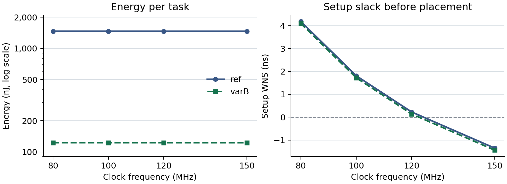

# 16×16 FP16 单头注意力设计报告

## 1. 设计目标与接口

实现 $Y=\operatorname{Softmax}(QK^\mathsf{T}/4)V$。四个矩阵均为 16×16，Softmax 按行计算。Q、K、V 与 Y 的接口采用 IEEE 754 binary16，输入范围为 [−2, 2]。三个顶层共用 [端口定义](../../hw/rtl/common/attn_ports.svh)，逐拍接收 Q/K/V 共 768 个元素，输出带地址和有效位的 256 个结果。验收采用 [题目一](../assignment/题目一-Transformer注意力模块-需求整理.md) 的逐位和精度判据。

## 2. 数值实现与架构

Q/K/V 入片后转换为定点。项目基线 ref 使用 16 位、13 位小数，varA/varB 使用 10 位、7 位小数，给 +2 和 −2 留出表示余量。点积使用宽整数累加，再按目标尺度执行最近偶数舍入。Softmax 先减行最大值，把指数换底为 2 的幂，整数部分用移位，小数部分用 16 段查表线性插值。每行求一次倒数，再逐元素相乘归一化。最终加权和舍入回 FP16。查询 [数值格式与误差分析](../theory/01-数值格式设计.md) 和 [C 软件模型](../../hw/model/attn_model.c) 可复核数值规则。

| 方案 | 数据流 | 主要取舍 |
|---|---|---|
| ref | 串行 $QK^\mathsf{T}$ → 按行 Softmax → 串行 $PV$ → 流式输出 | 串行复用乘加，保留中间矩阵，周期较长 |
| varA | 4 路 $QK^\mathsf{T}$ → 三级 Softmax → 4 路 $PV$ → 流式输出 | 并行点积减少计算拍数，$PV$ 跳过整组零。中间结果仍按矩阵保存 |
| varB | A 级 $QK^\mathsf{T}$ 和指数 → B 级倒数 → C 级归一化和 $PV$ → 流式输出 | 4 路点积配合跨行重叠，行缓冲替代整张 S/P 矩阵。指数行缓冲的释放时机会影响流水等待 |

串行乘累加每拍消费一对操作数，四路点积每拍消费四对。脉动阵列可复用相邻计算间的输入，但本任务单帧只有 16×16 个输出，且要计入 768 拍装载。项目采用四路折中，关键的数据流及分段周期图见 [汇报源稿](slides/ic_slides.tex)。

## 3. 表 1 功能与精度

本次复测使用 Verilator 5.032、完整测试集、seed 20260101，RTL 版本为 9cdb03c。表内每格是该类激励的最大单帧 RMSE / 最大绝对误差。每个方案逐位失配为 0，有限值检查通过。三方案使用同一输入与 float64 参考，按各自的定点格式选择逐位期望值。结果与 VCS V-2023.12-SP2 历史存档一致。

| 测试类别 | 每方案任务数 | ref | varA | varB |
|---|---:|---:|---:|---:|
| 随机 | 200 | 0.000125 / 0.000521 | 0.001863 / 0.006034 | 0.001863 / 0.006034 |
| 全零类 | 4 | 0.000073 / 0.000252 | 0.000537 / 0.001488 | 0.000537 / 0.001488 |
| 正负极值 | 200 | 0.000187 / 0.000590 | 0.000187 / 0.000590 | 0.000187 / 0.000590 |
| 相消 | 200 | 0.000140 / 0.000471 | 0.002492 / 0.005410 | 0.002492 / 0.005410 |
| 复位及恢复 | 4 | 0.000128 / 0.000573 | 0.001889 / 0.006034 | 0.001889 / 0.006034 |
| 连续任务 | 8 | 0.000117 / 0.000332 | 0.001728 / 0.005767 | 0.001728 / 0.005767 |
| 合计通过 | 616 | 616 / 616 | 616 / 616 | 616 / 616 |

[ref 回归摘要](../../hw/results/p4-sm40-20261120/rtl/ref-current.csv) · [varA 回归摘要](../../hw/results/p4-sm40-20261120/rtl/varA-current.csv) · [varB 回归摘要](../../hw/results/p4-sm40-20261120/rtl/varB-current.csv)

## 4. 表 2 同条件综合效率

表 2 使用 Genus 25.12 综合和 Innovus 25.12 活动反标。共同条件为 SMIC 40LL SC9MC RVT r1p1、TT 1.10 V / 25 °C、100 MHz、驱动单元 BUFH_X4M_A9TR40、输出负载 0.016 pF、时钟不确定性 5%、输入与输出延迟各 25% 周期。基线采用仓库当前 ref，最终方案选 varB。[历史三角综合汇总](../../hw/results/tables-sm40.md)

表 2 以同一 `random_0` 为代表样本。完整任务从第一次装载到最后一个有效输出，含装载 768 拍。100 MHz 下每拍为 0.01 µs。面积为综合标准单元面积。用零延迟门级 VCD 反标同一任务窗口，功率包含动态与泄漏，能耗为任务平均功率乘该任务时长。$J$ 用三项改善倍数的几何平均计算。

| 项目 | ref-sm40-tt | varA-sm40-tt | varB-sm40-tt |
|---|---:|---:|---:|
| 数值格式（Q/K/V 总位数 / 小数位） | 16 / 13 | 10 / 7 | 10 / 7 |
| 功能与精度 | 通过 | 通过 | 通过 |
| 综合面积 A（µm²） | 160,620.0 | 140,768.0 | 67,960.6 |
| 运行频率（MHz） | 100 | 100 | 100 |
| 完整任务周期 | 10,433 | 3,623 | 2,191 |
| 完整任务时延 D（µs） | 104.33 | 36.23 | 21.91 |
| 动态功率（mW） | 14.00769 | 11.87046 | 5.59505 |
| 泄漏功率（mW） | 0.01235 | 0.01114 | 0.00564 |
| 任务平均功率 P（mW） | 14.02004 | 11.88160 | 5.60069 |
| 单任务能耗 E（nJ） | 1,462.710 | 430.470 | 122.711 |
| 综合 setup WNS（ns） | +0.001 | 0.000 | 0.000 |
| VCD 反标覆盖率 | 99.67% | 98.58% | 98.95% |
| A₀/A | 1.00 | 1.14 | 2.36 |
| D₀/D | 1.00 | 2.88 | 4.76 |
| E₀/E | 1.00 | 3.40 | 11.92 |
| J | 1.00 | 2.24 | 5.12 |

四类代表激励的门级检查均通过，每项核对 256 个输出的地址与 FP16 值。相消激励下，varB 的跳零路径令任务缩短至 21.43 µs。零延迟波形未包含布线延时引起的毛刺。以下为成对的单任务能耗。[活动功耗及窗口汇总](../../hw/results/p4-sm40-20261120/power/summary.csv)

| 代表激励 | ref（nJ） | varA（nJ） | varB（nJ） |
|---|---:|---:|---:|
| random_0 | 1,462.710 | 430.470 | 122.711 |
| zero_0 | 1,414.652 | 414.781 | 111.026 |
| extreme_0 | 1,433.927 | 411.697 | 116.537 |
| cancel_0 | 1,456.718 | 335.643 | 114.953 |

## 5. 表 3 单变量优化

在 varB 中，只把指数行缓冲 erow 的释放点从 $PV$ 结束提前到归一化结束。归一化结束后，$PV$ 读取已生成的概率行和掩码，下一行可以复用 erow。两组使用相同的 SC9MC、TT、100 MHz、驱动负载、数值格式、四路并行度和测试 seed。前后 RTL 的差异见 [8dad36a](https://github.com/gravity-wh/attention/commit/8dad36ac5870fce04da2795bf8bad1c85b80502e)。

| 项目 | 调整前 | 调整后 | 变化 |
|---|---:|---:|---:|
| 缓冲释放点 | $PV$ 结束 | 归一化结束 | 提前 |
| 纯计算周期 | 1,738 | 1,423 | −18.1% |
| 完整任务周期 | 2,506 | 2,191 | −12.6% |
| 最大单帧 RMSE | 0.002492 | 0.002492 | 0 |
| 最大绝对误差 | 0.006034 | 0.006034 | 0 |
| 综合面积（µm²） | 67,867.5 | 67,960.6 | +0.14% |
| 完整任务时延（µs） | 25.06 | 21.91 | −12.6% |
| 任务平均功率（mW） | 5.53204 | 5.60069 | +1.24% |
| 单任务能耗（nJ） | 138.633 | 122.711 | −11.5% |

两版均用 Verilator 5.032、同一自检 testbench 和同批向量复跑，各 616 项全过、逐位失配为 0。两版都直接测得 768 拍装载。对照节省了 315 拍。面积取 Genus 25.12 的 TT 综合。功率取 `random_0` 的任务窗口反标，分别覆盖 98.95% 和 98.95% 的设计网。[调整前回归](../../hw/results/p4-sm40-20261120/rtl/varB-late-release.csv) · [调整后回归](../../hw/results/p4-sm40-20261120/rtl/varB-early-release.csv) · [原始功耗](../../hw/results/p4-sm40-20261120/power)

### Softmax 换底折叠实验

在 varB 装载 K 后，在原 QF 小数尺度上乘以定点常数 94548/65536 并做最近偶数舍入。Softmax 此时接收以 2 为底的指数差值，查表路径省去一次常数乘。独立试验补丁同时更新了逐位软件模型，float64 参考仍使用原始输入。616 项回归全过、逐位失配为 0，最大 RMSE 从 0.002492 增至 0.003656，最大绝对误差从 0.006034 增至 0.008309，均满足阈值。最坏完整周期仍为 2,191 拍。[折叠回归](../../hw/results/p4-sm40-20261120/rtl/varB-fold-l2e.csv)

| TT 100 MHz，random_0 | varB | fold_l2e |
|---|---:|---:|
| 综合面积（µm²） | 67,960.6 | 67,099.5 |
| 综合 setup WNS（ns） | 0.000 | 0.000 |
| Innovus 布局前 setup WNS（ns） | +1.722 | +1.859 |
| 单任务能耗（nJ） | 122.711 | 122.438 |
| VCD 反标覆盖率 | 98.95% | 100.00% |

折叠版面积下降 1.27%，任务能耗下降 0.22%，布局前 setup WNS 增加 0.137 ns。最终方案保留原版 varB 的精度，折叠版作为独立复现实验。[折叠综合](../../hw/results/p4-sm40-20261120/synthesis/varB-fold) · [折叠任务功耗](../../hw/results/p4-sm40-20261120/power/varB-fold/mhz100)

## 6. 固定网表扫频

对 ref、varB 分别固定 100 MHz 的 TT 映射网表，在 80、100、120、150 MHz 重放 `random_0`。时钟不确定性和 I/O 延迟随周期按原比例调整。功耗与 setup WNS 均在布局前估算。

| 时钟（MHz） | ref 能耗（nJ） | varB 能耗（nJ） | ref setup WNS（ns） | varB setup WNS（ns） |
|---:|---:|---:|---:|---:|
| 80 | 1,463.032 | 122.742 | +4.184 | +4.097 |
| 100 | 1,462.710 | 122.711 | +1.809 | +1.722 |
| 120 | 1,462.496 | 122.691 | +0.226 | +0.139 |
| 150 | 1,462.281 | 122.670 | −1.357 | −1.444 |

固定电压下，提高频率基本按比例增加平均动态功率、缩短任务时长，单任务能耗变化小于 0.06%。两个方案到 120 MHz 仍有布局前 setup 余量，150 MHz 都有违例。频率选择仍以 100 MHz 为主对照，并单独查看布线后时序。[扫频原始汇总](../../hw/results/p4-sm40-20261120/power/summary.csv)

## 7. 后端实现与证据

以当前 ref 和最终 varB 的 TT/100 MHz 综合网表启动 Innovus 25.12，输入网表的 SHA-256 与综合存档对应。两套设计按 55% 初始利用率设定核心区，输入放在左边、输出放在右边，IO 使用 M3。信号布线使用 M2 至 TM2，电源网络单独布线。两组共享由同一 tech LEF 派生的显式过孔规则。两套设计分别保存 CTS 检查点，再以单线程和相同的 8 轮详细布线设置恢复。寄生提取开启耦合电容，setup 使用 SS 0.99 V/125 °C，hold 使用 FF 1.21 V/−40 °C。

两套设计均已生成布线结果并完成 RC 提取和 STA。下表列出相同约束下的后端结果。

| 指标 | 当前 ref | varB |
|---|---:|---:|
| 布线后单元数 | 56,067 | 27,797 |
| 布线后单元面积（µm²） | 175,253.249 | 75,162.024 |
| 芯片占地（µm²） | 303,103.886 | 130,767.437 |
| SS setup WNS（ns） | −0.699 | −0.875 |
| SS setup TNS（ns） | −2004.100 | −183.698 |
| SS setup 违例路径 | 8,470 | 582 |
| FF hold WNS（ns） | −0.431 | −0.421 |
| FF hold TNS（ns） | −10411.000 | −4044.400 |
| FF hold 违例路径 | 28,408 | 11,353 |
| NanoRoute DRC 标记 | 291,435 | 115,649 |
| 连通性检查 | 通过 | 通过 |

varB 的布线后单元面积比 ref 小 57.1%，芯片占地小 56.9%。SS setup 的违例路径从 8,470 条降至 582 条，最差裕量从 −0.699 ns 变为 −0.875 ns。

两次运行均收到 NanoRoute 的 NRDR-30 告警，详细布线因 DRC 数量提前结束。另行执行的几何检查均达到 1,000 条报告上限。连通性检查通过，时序和几何仍有违例，签核条件尚未满足。[后端原始结果](../../hw/results/p4-sm40-20261120/pnr)

## 8. 复现

- [综合和回归存档](../../hw/results/sm40-rerun-20261114/README.md) 提供运行脚本、测试摘要和指标快照。
- [本次 P4 实验记录](../../hw/results/p4-sm40-20261120/README.md) 归档当前 RTL、综合、活动功耗和配对布线的证据。[复现命令](../../hw/experiments/p4/README.md)
- [汇报源稿](slides/ic_slides.tex) 使用仓库现有的东南大学 Beamer 模板。
